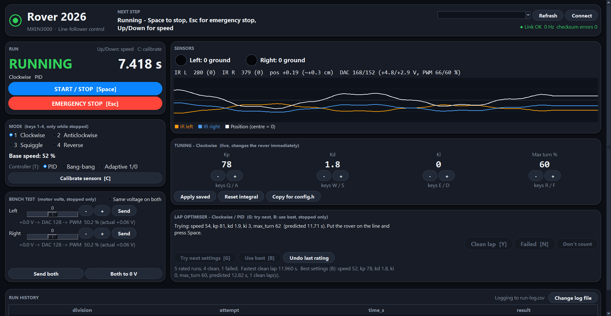

# rover2026 — wireless line-following rover (S2 2026)



*The control GUI, shown with simulated rover data.*

One firmware and one GUI cover all four competition runs: **Clockwise**, **Anticlockwise**, **Squiggle** and **Reverse**. The PC and the rover talk over a pair of XBees in transparent mode. The track is a stadium-shaped white line on a black table.

This is a clean rewrite. It keeps only the ideas from `../arduino/line_follower` and `../gui/serial_gui.py`: the DAC pin map, the 4-byte checksummed command frame, and neutral = 128. No code from `oldfiles/` is used.

```
firmware/rover2026/
  rover2026.ino   main loop, line follower, XBee link, failsafe
  config.h        pins, XBee options, per-mode tuning table  <- tune here
  protocol.h      frame format + command numbers (mirrors gui/protocol.py)
gui/
  rover_gui.py    Tkinter control panel (keyboard driven)
  protocol.py     frame encode/decode (mirrors protocol.h)
  optimizer.py    lap-time optimiser (Bayesian, pure Python) for the GUI
  test_protocol.py
  test_optimizer.py
  build_exe.bat   -> dist/RoverControl.exe (single executable for the competition)
  requirements.txt
```

## What's new (13 Oct 2026)

Ideas taken from [GilbertJ3072/MXEN3000](https://github.com/GilbertJ3072/MXEN3000) and rebuilt to run on the rover, not the PC:

- **3 controllers, one per mode:** PID, Bang-bang or Adaptive 1/0. Press `T` in the GUI to switch, also mid-run. No re-upload needed.
- **PID got better:** a smoothed derivative (less jitter) and an optional Ki with anti-windup (starts at 0, with a **Reset integral** button).
- **Lap optimiser:** after each run press `Y` (clean lap) or `N` (failed), then `G` for the next settings to try. `B` loads the best settings so far. It takes small steps and counts failed runs against nearby settings, because a failed run scores 0 in the competition. Full steps are in `gui/README.md` → "Lap optimiser".
- **Upload the firmware and rebuild the .exe together.** The tuning message changed, so an old GUI can't read the new firmware.

Why past students said "use bang-bang": their PID ran on the PC (about 100 ms late over serial) and read the sensors wrong (10-bit values stored in a byte). Ours runs on the rover every 5 ms, so start with PID and let the lap times decide.

## Quick start

1. Configure both XBees (see "XBee setup" below).
2. Open `firmware/rover2026/rover2026.ino` in the Arduino IDE. Pick board **Arduino Nano**, processor **ATmega328P**. Switch both levers of DIP switch **S6** off (it disconnects the XBee from D0/D1), upload, then switch S6 back on.
3. Run `gui/build_exe.bat`, then start `gui/dist/RoverControl.exe`. Alternatively run `python rover_gui.py` from `gui/`.
4. Pick the PC XBee's COM port and press **Connect**. The top bar turns green ("Link OK ~10 Hz").
5. Calibrate each IR sensor with its own pot: watch the SENSORS panel's 0-1 bars (1 = white line, 0 = black table). Hold the sensor over the white line and turn its pot until it reads above the right dashed mark (0.94), then check it reads below the left mark (0.30) over the black table. Match left and right. **Reset min/max** clears the min/max/gap columns.
6. Press **C** and slide the rover slowly across the line by hand for 3 s (software calibration, fine-tunes the 0-1 scaling).
7. Pick a mode (1–4), put the rover on the line and press **Space** to start.

## Keyboard (the supervisor drives with these)

| Key | Action |
|---|---|
| `1` `2` `3` `4` | Clockwise / Anticlockwise / Squiggle / Reverse (only while stopped) |
| `Space` | Start / stop |
| `Esc` | Emergency stop (always stops) |
| `Up` / `Down` | Base speed ±5 % (works live while running) |
| `C` | Calibrate sensors (only while stopped) |
| `T` | Next controller for this mode: PID / Bang-bang / Adaptive (also while running) |
| `Y` / `N` | Rate the last run for the optimiser: clean lap / failed |
| `G` / `B` | Optimiser: try next settings / use best settings (only while stopped) |

Each run also writes `ir-log_<Mode>_<timestamp>.csv` next to `run-log.csv`, with every telemetry sample (about 20 per second): `time_s, ir_left, ir_right, position, dac_left, dac_right, speed, line_lost`. Use it to plot the IR readings and tune thresholds.

Each run is timed from START to STOP and appended to `run-log.csv`. The columns match `labs/competition/run-log.csv`, so you can paste rows straight across.

## How the control works

- **Sensors.** Each IR reading is normalised to 0 (white) … 1 (black) using the calibrated levels. `position = right − left`. A positive value means the line has moved to the rover's left.
- **Three controllers, chosen per mode.** The `controller` column of `MODE_TUNING` in `config.h` sets each mode's starting controller, and the GUI can switch it (key `T`, also while running; the new controller starts with a cleared integral) without re-uploading. All three are compiled in. The default is PID, because the PCB gives analog voltages and the sensors are 3 cm apart over a 3 cm line.
- **PID steering (the default).** See "Analog steering" below for what `position` means. The derivative is low-pass filtered (`D_FILTER_ALPHA` in `config.h`, about a 25 ms average), because the raw change between two readings 5 ms apart is mostly noise. `ki` starts at 0 (plain PD). Add it only if the rover holds a steady offset on the long curves. The integral is capped so that `ki x integral` alone can never ask for more than `maxTurn` (anti-windup). It resets on START, while the line is lost, and from the GUI's **Reset integral** button.
- **Bang-bang steering.** Straight while `|position|` is below `bangLevel`, full `maxTurn` towards the line once it goes past. It has only two settings to tune, so it is quick to get working, but it zig-zags more than PID on the straights.
- **Adaptive steering (lecture 8, "2-sensor control algorithm").** Each sensor is either on the white line or off it. Both off (or both on) means go straight. Line under one sensor means steer towards that side. The turn rate is `adaptGain / (time since the last correction)`, so a rover that has just corrected turns hard, and one that has not corrected for a while turns gently. A second correction on the same side soon after the first adds to the earlier rate. While one correction lasts, the rate also ramps up by `adaptRamp` per second. All numbers are in `config.h`.
- **Analog steering (PID and bang-bang).** The controller turns `position` into a steering term, which is added to one wheel and subtracted from the other around the base speed. It runs every 5 ms. With the sensors 3 cm apart over the 3 cm line, a centred rover has each sensor on one edge of the line. Sliding sideways by less than 1.5 cm changes `position` smoothly (`position` = +-1 at +-1.5 cm). Between 1.5 and 3 cm one sensor is fully on the line and the other fully off, so `position` stays at +-1. Beyond 3 cm the line has left both sensors and is treated as lost. The GUI shows the approximate offset in cm next to `pos`.
- **Sensor geometry.** `SENSORS_STRADDLE_LINE` (adaptive controller only). `true` = the sensors sit either side of the line, as in lecture 8, so both off means straight and a lost line cannot be detected. `false` = both sensors sit over the line, so both off means the line is lost.
- **Sensor polarity.** `WHITE_READS_HIGH` in `config.h`. The sensor board has a 10k pull-up on each sensor output, so a sensor over the white line (lots of reflected light) reads LOW and black reads HIGH. That is the default (`false`). Set it to `true` only if a sensor over the line reads HIGH in the GUI's IR numbers.
- **Lost line.** When the line is lost (PID and bang-bang: both sensors on black; adaptive with `SENSORS_STRADDLE_LINE false`: both off the line), the rover first backtracks: it replays its last 0.6 s of wheel commands in reverse to retrace its path (`BACKTRACK_SAMPLES` / `BACKTRACK_SAMPLE_MS` in `config.h`), stopping as soon as a sensor sees the line. If the history runs out, it spins in place towards the side it last saw the line on (at the very start of a run, with no history, towards the mode's track direction). If it still can't find the line after 1.5 s in total, it stops.
- **Reverse.** Same controller, but the base speed is negative. The sensors stay at the front (now the trailing end), so this mode runs slower with more damping. `steerSign` in `config.h` flips the steering if testing shows it correcting the wrong way.
- **Link failsafe.** The GUI sends a heartbeat every 200 ms. If the rover hears nothing valid for 1.2 s, it stops and the built-in LED blinks fast. This keeps the rover from driving off the table if the radio drops.
- **Status LED (D13).** Solid = running. Fast blink = failsafe tripped. Off = stopped.

## Tuning order (about 30 minutes per mode)

All numbers are in `config.h` → `MODE_TUNING`. The current values are starting guesses.

1. Bench test first (GUI "Bench test" panel, rover lifted). Set each motor to 0 V (DAC 128) and confirm the wheel is still. Send about +6 V (DAC 180) and confirm the wheel drives forwards. If it goes backwards, flip `LEFT_MOTOR_DIR` / `RIGHT_MOTOR_DIR`.
2. Clockwise at base 30 %. Raise `kp` until the rover oscillates on the straights, then back off by a third.
3. Raise `kd` until the oscillation on curve entry stops. If the rover still sits off-centre on the long curves, raise `ki` in steps of 5. (Bang-bang: lower `bangLevel` until it reacts early enough on the curves, then lower `maxTurn` until it stops zig-zagging. Adaptive: raise the turn gain until the rover corrects fast enough on the curves, lower it if it zig-zags on the straights.)
4. To compare controllers, run the same mode with each one (key `T`). Each run's controller and settings go in the run log's notes column.
5. Raise base speed with `Up` during runs. Change the gains live from the GUI's TUNING panel (see `gui/README.md`). Press **Copy for config.h** and paste the best values into `MODE_TUNING`.
6. Repeat for the other modes. Squiggle needs higher gains. Reverse needs lower speed.

## Sensor placement (2 sensors only)

Recommended:

1. **Both at the front**, on the rover's centreline, about 5–8 cm ahead of the drive-wheel axle. More distance gives earlier warning on curves, but makes the rover cut corners.
2. **Spacing (centre to centre): 3 cm, equal to the 3 cm line width (the plan).** Each sensor then sits over one edge of the line when the rover is centred, so it reads grey, not fully white or black, which gives a smooth proportional error (analog PD, the default). Keep the spacing close to 3 cm and keep both sensors the same height. If you ever switch to the adaptive controller, the sensors must be wider than the line, about 4-5 cm.
3. **Height about 3–8 mm** above the table (check the sensor datasheet; the lecture slide gives "0.12–0.18", most likely inches, which is 3–4.6 mm). Shroud the sensors from room light.

Trade-off: the front position is right for Clockwise (compulsory, 6 marks), Anticlockwise and Squiggle. In Reverse the sensors trail behind the wheels, which is harder to keep stable. With only 2 sensors, **Squiggle or Anticlockwise is the safer choice for the 3-mark division**. Reverse is still implemented, so you can try it in practice.

## XBee setup

Follows the unit's `../Xbee Pairing Guide.pdf` (XBee S2C, transparent mode, 38400 baud).

**Easiest: the GUI's Pair XBees button.** It sends the same settings as the guide's XCTU steps, no XCTU needed. Hardware as in guide steps 1-2: XBee on the V0 shield, shield switch on **USB**, empty sketch uploaded to that Arduino. On a breadboard instead of the V0 shield, wire it as a pass-through: XBee DIN to Arduino **D0 (RX)**, XBee DOUT to **D1 (TX)** (the opposite of normal use), XBee on 3.3 V, and a 5 V-to-3.3 V divider on DIN unless the XBee sits on a 5 V adapter board.

1. PC XBee on the shield. Press **Pair XBees**, pick the Arduino's port, press **Program PC XBee**.
2. Swap in the rover XBee, press **Program rover XBee**. It gets the PC XBee's serial number as its destination.
3. Swap the PC XBee back in, press **Program PC XBee** again. It gets the rover's serial number.
4. The window says "Paired". Put each XBee on its own board and press **Connect**.

It finds the XBee at 38400 or any other baud rate, writes all settings at once (ATWR, guide step 17), reads them back to check them, remembers both serial numbers in `xbee.json`, and refuses to program the wrong XBee in step 3.

**Zigbee firmware:** the guide sets CE = 0 on both. That links on 802.15.4 firmware, but on Zigbee firmware (the guide's screenshot shows "ZIGBEE TH Reg") one XBee must be the coordinator (CE = 1). The GUI checks the firmware (ATZS): on Zigbee it ticks **PC XBee as coordinator** and sets CE = 1 on the PC XBee in the third pass.

**By hand (XCTU):** follow the guide. The settings it ends up with:

| Setting | PC XBee | Rover XBee | Guide step |
|---|---|---|---|
| ID (PAN ID) | random, same on both | same | 11, 19 |
| CE | `0` (`1` on Zigbee firmware) | `0` | 12 |
| NI | `PC` | `ROVER` | 14 |
| BD | `5` (38400) | `5` (38400) | 15 |
| AP | `0` (transparent) | `0` | 16 |
| DH / DL | rover's SH / SL | PC's SH / SL | 20, 22 |

The firmware (`LINK_BAUD` in `config.h`) and the GUI both use 38400 to match.

## Wiring (checked against the PCB schematics in `docs/pcb details/`)

- **XBee:** the PCB's XBee connector J10 reaches Nano D0 (RX) / D1 (TX) through DIP switch S6, which matches the default `config.h` (`LINK_USE_SOFTWARE_SERIAL 0`). J10 supplies +5 V, so the XBee must sit on a 5 V adapter board (regulator + level shifting). Turn S6 off to upload over USB. `LINK_USE_SOFTWARE_SERIAL 1` (D12 RX / D13 TX) is only for a hand-wired XBee that bypasses J10; D12 and D13 are unused on the PCB.
- **DACs (LSB first):** the second board's DAC (called left in `config.h`) = D9, D8, D7, D6, D5, D4, D3, D2 (changed 2026-10-12; the schematic order was D2, D3, D4, D5, D9, D8, D7, D6). The first board's DAC (right) = A2, A3, A4, A5, A1, A0, D11, D10, which is the DAC0800 data inputs B8..B1 order from the schematic. Which DAC drives which physical wheel is not in the schematics: confirm it with the bench test and swap the pin arrays or flip `LEFT_MOTOR_DIR` / `RIGHT_MOTOR_DIR` if needed.
- **IR sensors:** connector J8 = GND, A6, A7, 5 V (LED supply through R2 180 Ω). A6 and A7 have 10 kΩ pull-ups (R3, R4) and no comparator, so the readings are analog: white line = low, black table = high (`WHITE_READS_HIGH false`). The firmware calls A6 left and A7 right; if the GUI shows them swapped, swap `IR_LEFT_PIN` / `IR_RIGHT_PIN`.
- **PWM jumpers (not set by firmware):** each DAC output must reach the LM393 comparator against the ramp. Board 1: J7 on 1-2 (DAC → +RAMP1), J1 on 2-3, J5 on 2-3 (ramp, not +5 V). Board 2: J12 on 1-2 (-RAMP2). With the wrong jumpers a wheel ignores its DAC.
- **Power:** the Nano runs from VIN (L7809 + diode D1); the motor stages from the ±15 V input J14. DAC 128 ≈ 50 % duty ≈ 0 V at the motor.

## Checks done

- Firmware compiles for Arduino Nano (arduino-cli, `--warnings all`) with no warnings: 8.7 kB of 30 kB, 595 B of 2 kB RAM (checked 2026-10-13, all three controllers compiled in).
- Pin map re-checked against `labs/lab4-final-vehicle/PCB_Circuits_Diagrams (1).pdf` (board 1 netlist) and `docs/pcb details/sch3.pdf` (board 2) on 2026-10-06.
- `python test_protocol.py`: 13 protocol tests pass (framing, checksum, resync after garbage, tuning frame). `python test_optimizer.py`: 8 tests pass, including a simulated track where 20 runs cut the lap time by more than 15 % (checked 2026-10-13).
- The GUI exercised with simulated telemetry (mode change, speed, start, line-lost auto-stop, CSV log), and `build_exe.bat` produces an ~11 MB `RoverControl.exe`.
- **Not yet run on the real rover or radios.**
